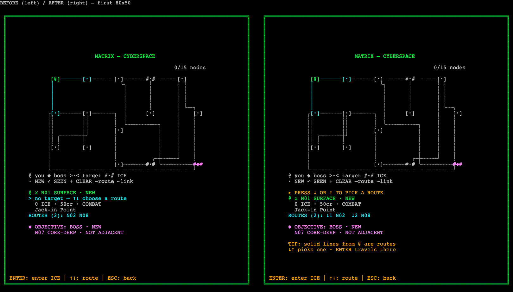

# Matrix affordance — evidence, 2026-11-01

Follow-up to [ADR-0249](../../wiki/decisions/0249-matrix-operation-board.md). Owner play-test: "선이 연결되는 느낌은 좋아. 그런데 어떻게 해야 하는지 잘 알아보지는 못하겠어 … 목록보다는 훨씬 좋아." The board was kept; the gap closed was **legibility of the action**. Renderer + onboarding-hint change only: reducer, selection semantics, arrow cycle order, encounter verbs, prices, tuning, RNG, `status.ts`, dungeon crawler and VFX are unchanged. Unstaged, uncommitted.

## What changed on screen

| # | Before | After |
| --- | --- | --- |
| 1 | `ROUTES (4): N01 N07 N09 N10` — key mapping had to be inferred | `ROUTES (4): ↓1 N01  ↓2 N07  ↓3 N09` + continuation row `↓4 N10` — ↓k = press ArrowDown k times. With a target: `>N01  ↓1 N07  ↓2 N09 / ↓3 N10` (presses counted on from the target, exactly the reducer's cycle). Wraps under the first entry instead of clipping (40 cols). |
| 2 | Card line 2, cyan: `> no target — ↑↓ choose a route` under `@ …` | Card line 1, amber: `▸ PRESS ↓ OR ↑ TO PICK A ROUTE`, then `@ …`. Names no room → cannot read as a selection. Once a target exists line 1 is `> ⚔ N01 …`, its detail under it, then `@ …`; footer `ENTER: travel`. No-route nodes: `▸ NO ROUTES — ENTER: ICE`. |
| 3 | — | One-time hint under the card on the first board with a route: `TIP: solid lines from @ are routes` / `↓↑ picks one · ENTER travels there`. Gone after the first input made on the board. |
| 4 | (optional) | Not done — the card row order already separates "now" from context; extra corridor styling would add clutter at 40×60. |

## Captures

Actual `renderMatrix` grids drawn through the game's `AsciiRenderer` (esbuild bundle, headless Chromium, 10×18 cells, DPR 1), same method as the previous two slices; [capture-receipt.json](capture-receipt.json). Fixture: grade 3, seed 42 ([fixture.json](fixture.json)). States: **first** (jack-in, hint on in after; before had no hint), **start** (jack-in, later visit), **rest** (node 2, 4 routes, no target), **branch** (node 2, target N01), **boss**. Before = HEAD `bfadddcf` before any edit.

| Grid | Pairs (before left / after right) |
| --- | --- |
| 80×50 | [first](first-80x50-pair.png) · [start](start-80x50-pair.png) · [rest](rest-80x50-pair.png) · [branch](branch-80x50-pair.png) · [boss](boss-80x50-pair.png) |
| 60×40 | [first](first-60x40-pair.png) · [start](start-60x40-pair.png) · [rest](rest-60x40-pair.png) · [branch](branch-60x40-pair.png) · [boss](boss-60x40-pair.png) |
| 40×60 | [first](first-40x60-pair.png) · [start](start-40x60-pair.png) · [rest](rest-40x60-pair.png) · [branch](branch-40x60-pair.png) · [boss](boss-40x60-pair.png) |

Raw text: `<state>-<size>-{before,after}.txt`. Width checks: `*-width-check.json` (15/15: exact width, 0 overflow, no border drift, no ANSI). [layout-evidence.json](layout-evidence.json): rails intact, action line present, PNG fresh — all 15.

## Tests

New [`web/tests/matrix_affordance.test.ts`](../../../web/tests/matrix_affordance.test.ts), 20 tests: **20 failed before** ([affordance-tests-before.txt](affordance-tests-before.txt)) → **20 passed**. Covers: each `↓k Nxx` honoured by k real `move_south` reducer actions (rest + every target, 3 layouts); mapping stated and unclipped for all 3132 stress cases; prompt first line, no target token/line at rest; target ⇒ prompt gone + footer travel; no-default-target after arrival and with the hint drawn; hint gate (once / matrix only / no decision open / needs a route), hint below the card and changing nothing else (60 matrices × 3 layouts); `main.ts` wiring. Existing ROUTES assertions in 5 files were migrated to the stricter new format (none removed). `matrix_board.test.ts` (incl. 3132-case stress) unchanged and green.

## Verification

| Command | Result |
| --- | --- |
| `npm run typecheck` | 0 errors |
| `npm run lint` | 0 errors; pre-existing `src/input/keyboard.ts:14` warning |
| `npm test` | **168 files / 3774 passed / 0 failed** (baseline 167 / 3754, +1 file / +20) |
| `npm run build` | PASS |
| `npx prettier --write/--check` on edited `src/**` only | PASS |
| `npm run balance` / `-- --deck ppl` | [opening](balance-opening.txt) / [PPL](balance-ppl.txt): `cmp` byte-identical to the previous slice and to the ADR-0239 baseline files |
| E2E (`env -u CI PLAYWRIGHT_BASE_URL=http://127.0.0.1:5195 … --grep-invert demo-screenshots`) | **82 passed / 4 skipped / 0 failed (4.6m)** ([e2e.txt](e2e.txt)); preview pid 75395 untouched, serving the rebuilt `dist/`; `gotoEncounterDecision` unedited |
| Frontend draft guard | clean, 4 files |
| LSP | not available (no TS server); `tsc` is the gate |

## LOC (total / pure)

| File | Before | After |
| --- | --- | --- |
| `renderer/matrix.ts` | 188 / 155 | 203 / 167 |
| `renderer/matrix_nodes.ts` | 100 / 82 | 138 / 109 |
| `renderer/run_screen.ts` | 129 / 121 | 131 / 123 |
| `core/state/onboarding.ts` | 109 / 47 | 146 / 72 |
| `main.ts` (pre-existing over cap) | 1740 / 1523 | 1747 / 1528 |

## Visual QA — fixed dark ASCII canvas

Contrast measured ([contrast.json](contrast.json)), 4 palette modes × standard/high-contrast: prompt/hint `YELLOW_AMBER` **≥ 10.15:1**; minimum of all card/board tokens **6.58:1**. Independent read-only reviewer read all 15 after captures + 5 PNGs and checked every ↓k against fixture adjacency: **PASS**, no findings.

| Item | Verdict | Note |
| --- | --- | --- |
| Primary action unmistakable at rest | PASS | amber `▸ PRESS ↓ OR ↑…` is card line 1 |
| Key → destination stated, not inferred | PASS | `↓k Nxx`, reducer-verified |
| Prompt is not a selection | PASS | names no room; no `>·<` on board; reducer `selected === null` |
| Required content at all 3 layouts, unclipped | PASS | stress + 15 width checks |
| Rails / frame / footer intact | PASS | layout-evidence, stress |
| Text contrast ≥ 4.5:1 | PASS | measured, min 6.58:1 |
| Colour not sole carrier | PASS | `▸` / `>` / `@` / `↓k` glyphs carry meaning |
| One-time hint, dismissable, no second system | PASS | ADR-0235 onboarding module + controller flag |
| Density at 40×60 | PASS (taste) | card stays 8 rows (route continuation row replaces the former blank spacer); board unchanged |
| Motion / travel feedback | N/A | out of slice |
| Per-row focus ring | **FAIL (inherited)** | canvas, unchanged |
| Semantic accessibility tree | **FAIL (inherited)** | canvas, unchanged |

Known limit: the hint is once per page session (same scope as the combat-entry hint flag), not persisted per profile.
