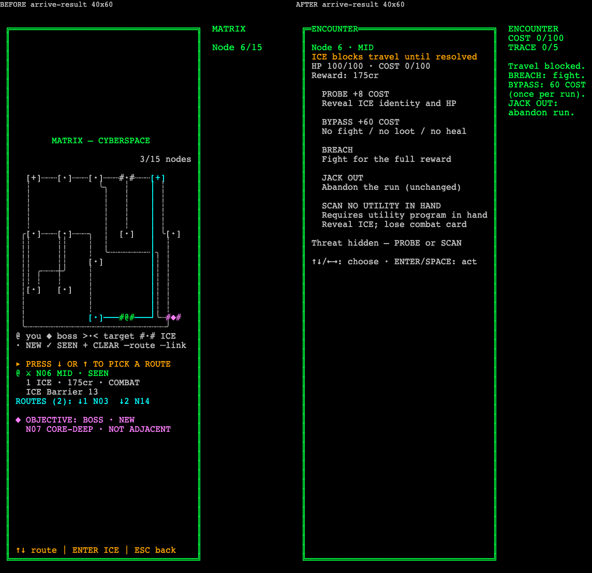
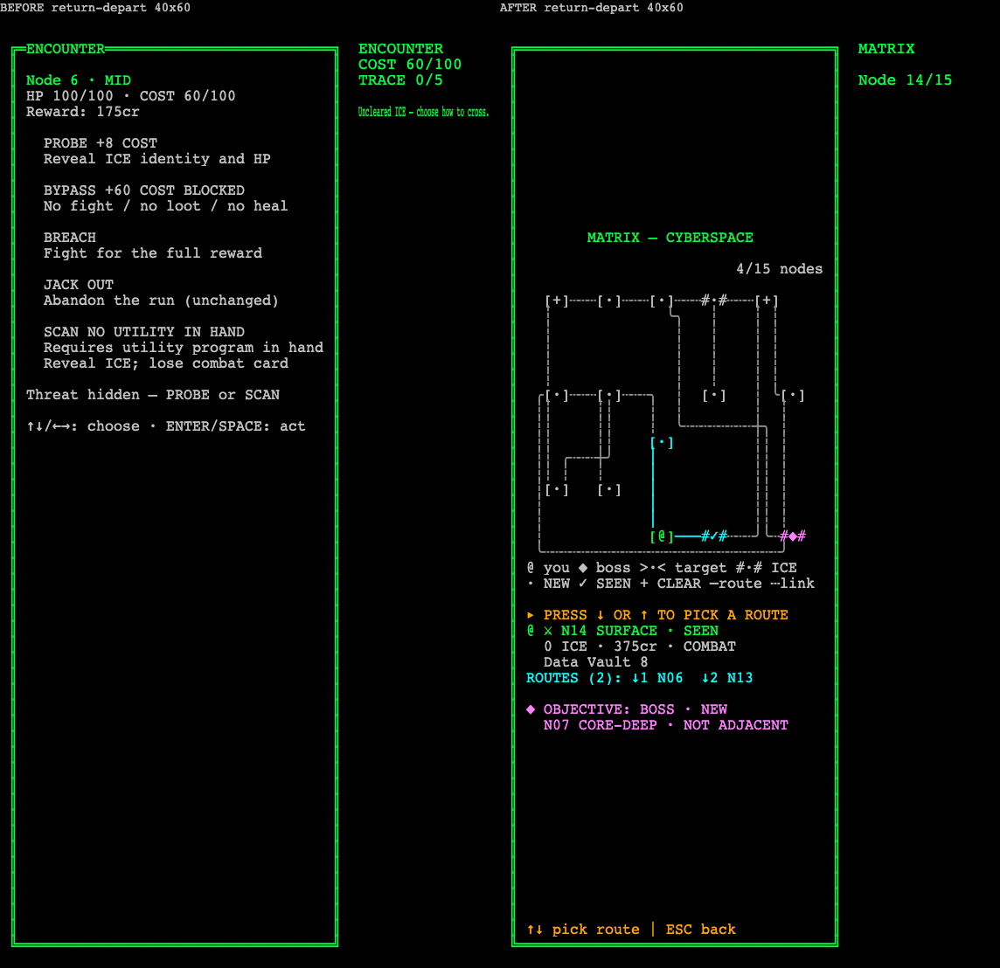

# Matrix entry gate — evidence, 2026-11-02

Implements [ADR-0250](../../wiki/decisions/0250-encounter-gate-on-entry.md) (Accepted, owner: "그래 C로 가자"). Owner report being fixed: "이벤트가 끝나고 좌우 두군데 밖에 선택지가 없는데 계속 이벤트가 반복되서 빠져나오지 못했어." Unstaged, uncommitted.

## What the player sees now

| Moment | Before (HEAD `365e379f`) | After |
| --- | --- | --- |
| Route to an unresolved ICE node targeted | footer `ENTER: travel` | footer `ENTER: enter ICE \| ↑↓: route \| ESC: back` (narrow: `↑↓ route \| ENTER ICE \| ESC back`) |
| Enter | moves; board; message `Moved to mid — ENTER: encounter; arrows: route`; no event | moves **and** the encounter screen opens in the same keypress; `ICE blocks travel until resolved` under the node name; HUD: `Travel blocked.` / `BREACH: fight.` / `BYPASS: 60 COST` / `(once per run).` / `JACK OUT:` / `abandon run.` |
| After BYPASS, leave and come back | the pass is forgotten: on return, Enter on any route reopens `Uncleared ICE — choose how to cross.` and BYPASS (60 → 120 > 100) is no longer payable: **the reported loop** | the node is in `bypassedEncounterNodes`; return shows the board, footer `↑↓: pick route \| ESC: back`; Enter with a route travels |
| Standing on unresolved ICE without an arrival (run start / CONTINUE), route targeted | footer `ENTER: travel`, but Enter opens the encounter | footer `ENTER: enter ICE \| ICE blocks travel \| ESC: back` (narrow `ENTER ICE \| no travel \| ESC back`) |
| At rest on a resolved / ICE-free node | footer `ENTER: enter ICE …`, Enter does nothing useful | footer `↑↓: pick route \| ESC: back` |

## State

- New run-scoped saved field `bypassedEncounterNodes?: ReadonlyArray<number>` on `GameState` and `SaveSlot`. **Removed** `bypassedEncounterNodeIndex` (single slot, per visit, unsaved).
- Resolved = `clearedEncounterNodes ∪ bypassedEncounterNodes` (`encounterResolved`, `encounterGates` in `encounter_verbs.ts`, shared by the reducer and the footer logic in `matrix.ts`).
- Confirm in `applyMatrixAction`: (1) current node gates → open decision (no departure); (2) target adjacent → move; if the destination gates, the **same returned state** carries `encounterDecision: {selectedVerb: null, probed: false}` and the gate message; (3) resolved current node, no target → `Encounter resolved — choose an adjacent route.` (no reopen).
- Unchanged: PROBE 8 / BYPASS 60 / limit 100 / BREACH 0 / JACK OUT 0, `bypassBlockReason` (boss / no adjacency), the terminal-node completion in `applyLootAction`, SCAN, RNG, arrow cycle order, dungeon, `clearedEncounterNodes` save contract, schema `version: 1`.
- Superseded by the ADR (decision 2/4) and therefore changed: a BYPASS-resolved node can no longer be re-opened with a bare Enter to BREACH it for its reward later. The cost of that ICE was paid once.

## Travel animation decision

When the arrival opens the decision, **no traversal is started** (`beginMatrixTravel` returns null if `next.encounterDecision`). Reasons: `renderRunScreen` draws the encounter screen whenever a decision is open, so travel frames would be computed and never shown; delaying the encounter screen behind 220 ms of board frames would show a board whose keys no longer drive it (arrows already cycle verbs, Enter already acts on the hidden menu), which is misleading. The encounter screen appears in the confirming frame and its first line names the node arrived at. Free arrivals still animate exactly as before; reduced motion, targeting, CONTINUE and phase changes still never animate (existing `matrix_travel.test.ts` unchanged and green). The state commits in the same action either way.

## Captures

Actual `renderRunScreen` grids (`renderMatrix` / `renderEncounterDecision`) plus the HUD column at the preset width (24/20/16), drawn through the game's `AsciiRenderer` (esbuild bundle, headless Chromium, 10×18 cells, DPR 1), the same method as the previous Matrix slices; [capture-receipt.json](capture-receipt.json). Driven by the real reducer from a fixture (seed 42, grade 3): N06 is a non-boss ICE node with exactly two neighbours (N03, N14), the owner's case ([fixture-before.json](fixture-before.json), [fixture-after.json](fixture-after.json)).

| Case | 80×50 | 60×40 | 40×60 |
| --- | --- | --- | --- |
| `arrive-commit` (N03 → N06 targeted) | [pair](arrive-commit-80x50-pair.png) | [pair](arrive-commit-60x40-pair.png) | [pair](arrive-commit-40x60-pair.png) |
| `arrive-result` (one Enter) | [pair](arrive-result-80x50-pair.png) | [pair](arrive-result-60x40-pair.png) | [pair](arrive-result-40x60-pair.png) |
| `encounter` (decision screen) | [pair](encounter-80x50-pair.png) | [pair](encounter-60x40-pair.png) | [pair](encounter-40x60-pair.png) |
| `return-rest` (BYPASS → N03 → back to N06) | [pair](return-rest-80x50-pair.png) | [pair](return-rest-60x40-pair.png) | [pair](return-rest-40x60-pair.png) |
| `return-route` (N14 targeted) | [pair](return-route-80x50-pair.png) | [pair](return-route-60x40-pair.png) | [pair](return-route-40x60-pair.png) |
| `return-depart` (Enter) | [pair](return-depart-80x50-pair.png) | [pair](return-depart-60x40-pair.png) | [pair](return-depart-40x60-pair.png) |
| `gated-route` (on unresolved N06, no arrival) | [pair](gated-route-80x50-pair.png) | [pair](gated-route-60x40-pair.png) | [pair](gated-route-40x60-pair.png) |

Raw text: `<case>-<size>-{before,after}.txt` + `.hud.txt`. `return-route` is pixel-identical before/after (`diffRatio 0`): the same footer `ENTER: travel` was a lie at HEAD (Enter reopened the encounter, `return-depart` before) and is true now. Width checks: **21/21 after frames** exact width, 0 overflow lines, no border drift, no ANSI (`*-after-width-check.json`). Measured widths: longest wide footer 48 chars at inner 56 (60×40); narrow footers 24–34 chars at 35 usable cells (40×60); gate line 32 chars in a 34-cell text width (40×60); HUD message lines max **15** chars in the 40×60 HUD (16 cols, one reserved by `drawHud`). The footer falls back to its short form whenever the long one would not fit (`matrixFooter`).

Live, on the preview build served by `127.0.0.1:5195` (pid 75395, `index-De0KFiDO.js`), real keys in a separate browser ([live-desktop-chromium.json](live-desktop-chromium.json), [live-mobile-portrait-chromium.json](live-mobile-portrait-chromium.json)): one Enter took `cur 0, sel 1` → `cur 1, decision open, verb null, alarm 0`; BYPASS → `alarm 60, bypassed [1]`; away → back → away again with the decision closed every time. Screens: [desktop arrival](live-desktop-chromium-arrival.png), [mobile arrival](live-mobile-portrait-chromium-arrival.png), [desktop return](live-desktop-chromium-return.png), [mobile return](live-mobile-portrait-chromium-return.png). On the 393 px phone the 15-char HUD lines end ≈3 device px from the canvas edge, fully legible (the HUD has always been sized this way).

## Tests

New [`web/tests/encounter_entry_gate.test.ts`](../../../web/tests/encounter_entry_gate.test.ts), 28 tests. At HEAD: **26 failed / 2 passed** ([tests-before.txt](tests-before.txt)); the two that pass are anti-exploit guards that already held (no walking past an open decision; no free departure from an unresolved node). After: **28 passed** ([tests-after.txt](tests-after.txt)). Between the red run and the green run one helper line changed (`findLastIndex` → `lastIndexOf`, for the ES2022 lib typecheck); no assertion changed.

| Contract | Proof |
| --- | --- |
| Arrival opens the decision in the same action, and the move commits | one `confirm`: `currentNodeIndex` = destination, `visitedNodes` ∋ destination, `turnCount + 1`, `encounterDecision = {null, false}`, `runPhase matrix`, `alarm 0`, render HUD[0] `ENCOUNTER` |
| No walking past | arrows / Enter without a verb never change the node |
| Departure from an unresolved node reached without arrival (CONTINUE) stays gated | targeted route + Enter → same node, decision open |
| Arrival message names the ways forward and fits | message has `Travel blocked`, `BREACH`, `BYPASS: 60 COST (once per run)`, `JACK OUT`; every 40×60 HUD line ≤ 15 |
| Screen states the gate once | `ICE blocks travel` exactly once at 80×50 / 60×40 / 40×60 |
| BYPASS memory + 2-neighbour exit | `bypassedEncounterNodes [1]`, no `bypassedEncounterNodeIndex` key; both neighbours leave with no decision |
| Run-scoped memory | away → back → away: no decision, `[1]` kept, COST and credits unchanged; bare Enter on it does not reopen |
| Combat-resolved node | leave and re-enter freely |
| Anti-exploit / one BYPASS | the boss opens on arrival; BYPASS refused there, list unchanged |
| Footer truth | on gated node + target: Enter opens the encounter and the footer has no `ENTER:? travel`; on free target: says travel and Enter moves; whole fixture walk: no frame claims travel where Enter opens the encounter |
| Save | storage round trip `[2, 5]`, `version 1`; old slot without the field loads, no property, restores `[]`; malformed lists rejected |
| Travel animation | no traversal when the arrival opens a decision; a free arrival still animates |

### Existing tests changed (contract change, stated explicitly)

| Test | Why | Change |
| --- | --- | --- |
| `encounter_verbs` "can return to a bypassed uncleared node and Breach…" | encoded ADR-0246 243행 per-visit pass, superseded by ADR-0250 decision 2 | now "returns to a bypassed node without reopening, charging or rewarding it (ADR-0250)" |
| `encounter_verbs` "refuses a second BYPASS…" | used the removed field and re-bypassed the same (now resolved) node | second attempt on another unresolved ICE node (fixture adds node 2); all original assertions kept (alarm 60, player/inventory equal, BLOCKED shown, departure stays gated) |
| `encounter_verbs` "spends program headroom…" | reached combat by re-opening the bypassed node | fixture puts ICE on node 1; BREACH it on arrival; same assertions |
| `encounter_programs`, `encounter_bypass_eligibility` | read the removed field (vacuous `undefined`) | same assertion on `bypassedEncounterNodes` (now non-vacuous) |
| `matrix_board` rule 4 | asserted "arrival opens no verb"; ADR-0249 rule 4 says arrival **may** open the overlay with no default/auto-execution | asserts the overlay opens with `selectedVerb null`; the rest unchanged |
| `matrix_frame` footer row | pinned the old gated-node wording | new wording, same row |
| `matrix_affordance` at rest | expected `ENTER: enter ICE` on the ICE-free start node, where Enter does nothing | expects `↑↓: pick route` |
| `e2e/continue.spec.ts:195` | read the removed field | `bypassedEncounterNodes` contains the node |

`e2e/menu-nav.ts` is **unchanged**: `gotoEncounterDecision` walks to the first ICE node, sees the decision already open, and its extra Enter is a no-op on a null verb.

## Verification

| Command | Result |
| --- | --- |
| `npm run typecheck` | 0 errors |
| `npm run lint` | 0 errors; pre-existing `src/input/keyboard.ts:14` warning |
| `npm test` | **170 files / 3817 passed / 0 failed** (baseline 169 / 3789, +1 file / +28) |
| `npm run build` | PASS (`index-De0KFiDO.js`, `game-core-BkKB0MXO.js`) |
| `npx prettier --write` on the 9 edited `src/**` files; `--check "src/**/*.{ts,tsx}"` | PASS |
| `npm run balance` / `-- --deck ppl` | [opening](balance-opening.txt) / [PPL](balance-ppl.txt): `cmp` byte-identical to `matrix-travel-animation-2026-11-01/balance-*.txt` and to `bypass60-*.txt`; opening `100.0 / 88.3 / 70.5 / 39.5 / 36.2 / 0.0`, PPL `100.0 / 79.1 / 98.9 / 83.0 / 44.4 / 24.7` (ADR-0239). The harness never walks the graph, so this proves the combat harness is untouched, not the route economy |
| E2E `env -u CI PLAYWRIGHT_BASE_URL=http://127.0.0.1:5195 npx playwright test --ignore-snapshots --grep-invert demo-screenshots` | **82 passed / 4 skipped / 0 failed (4.6m)** ([e2e.txt](e2e.txt)); preview pid 75395 not killed, serving the rebuilt `dist/` |
| Frontend draft guard (`check-draft-guard.ts` via `npx tsx`) | clean, 6 files |
| LSP | not available (no TS server); `tsc` is the gate |

## LOC (total / pure, pure = non-blank, non-comment)

| File | Before | After |
| --- | --- | --- |
| `core/types.ts` | 514 / 352 | 517 / 353 |
| `core/state/state.ts` | 406 / 350 | 409 / 353 |
| `save/storage.ts` | 276 / 217 | 283 / 223 |
| `core/state/encounter_verbs.ts` | 196 / 182 | 228 / 208 |
| `core/state/state_actions_phases.ts` | 370 / 328 | 379 / 336 |
| `renderer/matrix.ts` | 223 / 183 | 253 / 208 |
| `renderer/encounter.ts` | 115 / 114 | 132 / 127 |
| `renderer/run_screen.ts` | 135 / 126 | 136 / 127 |
| `renderer/matrix_travel.ts` | 185 / 146 | 188 / 147 |
| `tests/encounter_entry_gate.test.ts` (new) | — | 330 / 261 |

All touched modules stay under the ADR-0110 ~250 pure-LOC cap except the pre-existing `types.ts`, `state.ts` and `state_actions_phases.ts`, which were already over it.

## Visual QA

Contrast ([contrast.json](contrast.json)), 4 palette modes × standard/high-contrast: gate line and footers (YELLOW_AMBER on black) **≥ 10.15:1**; HUD message (GREEN_NEON) **≥ 13.96:1**; verb rows (GRAY_LIGHT) **≥ 11.54:1**.

Independent read-only reviewer (all 21 after text frames + HUD files, fixtures, live logs): **PASS**, no defects or taste findings.

| Item | Verdict | Evidence |
| --- | --- | --- |
| Footer never claims travel when Enter opens the encounter | PASS | `arrive-commit` / `gated-route` all sizes: `ENTER: enter ICE …` / `ENTER ICE \| no travel` |
| Footer says travel when Enter travels | PASS | `return-route` all sizes `ENTER: travel` (and `return-depart` after = moved) |
| No `enter ICE` promise at rest on resolved node | PASS | `return-rest` all sizes `↑↓: pick route` |
| Gate stated once on encounter screen | PASS | one `ICE blocks travel until resolved` line, all sizes |
| Arrival message names BREACH / BYPASS / JACK OUT, fits HUD | PASS | max 15 chars at 40×60 (16-col HUD) |
| All verbs, prices, details, controls kept | PASS | five verbs + detail rows unchanged |
| Rails / frame / no overflow / no drift | PASS | 21/21 width checks |
| Text contrast ≥ 4.5:1 | PASS | min 10.15:1 |
| Colour not sole carrier | PASS | gate stated in words; footer wording differs per state |
| Motion | PASS | no hidden travel frames under the encounter; reduced motion unchanged |
| Copy plain | PASS | no marketing wording |
| Per-row focus ring | FAIL (inherited) | canvas, unchanged |
| Semantic accessibility tree | FAIL (inherited) | canvas, unchanged; the gate message is not announced to assistive tech |

## Known limits

- The board still draws a BYPASS-resolved node with `#·#` ICE brackets (the board's `CLEAR` state means cleared by combat); the footer and the reducer treat it as resolved. Not changed in this slice.
- The open risk recorded in ADR-0250 (rhythm cost of a forced decision on arrival) can only be judged by play.
