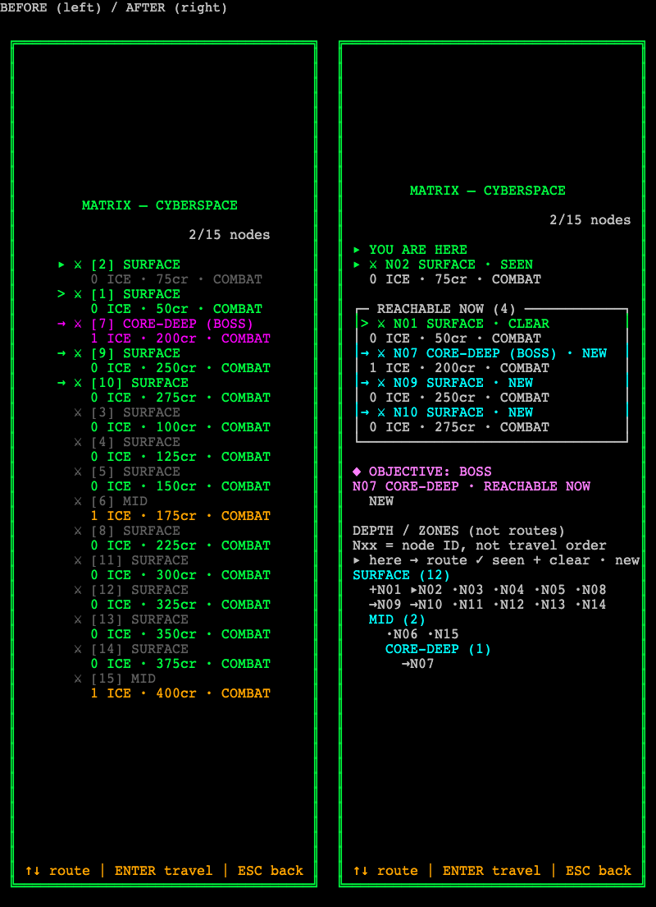
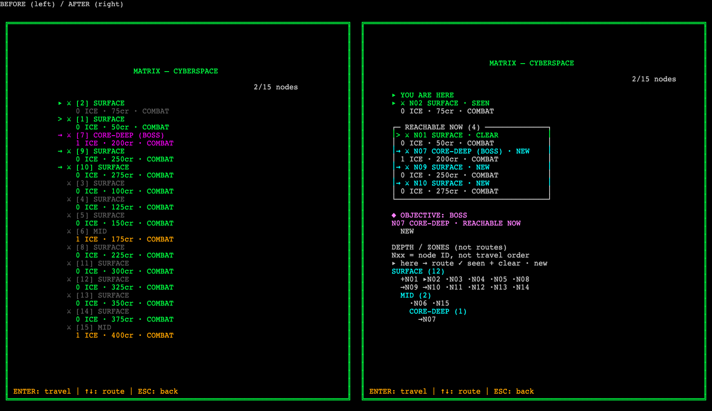

# Matrix legibility — evidence, 2026-11-01

Renderer-only response to the owner's play-test complaint: the Matrix list structure was hard to understand. No gameplay, tuning, prices, RNG, input, dungeon crawler, VFX, palette values or ADR decision content changed. Work is unstaged and uncommitted.

## Before / after

These are **actual `renderMatrix` outputs**, not mockups. Baseline text and cell grids were captured **before editing**. PNGs draw those saved grids through the game's actual `AsciiRenderer`, using identical 10×18 px cells, system monospace fallback, DPR 1, and no external HUD. This is a deterministic renderer harness, not a screenshot of an injected live play session. Temporary cell-by-cell JSON intermediates were removed after capture; raw text, PNGs, fixture and receipts remain.

Fixed cases: grade 3, seed 42, 15 nodes; start, branch at index 1, and boss at index 6; each at 80×50, 40×60 and 60×40. The branch has four neighbours: indices 0, 6, 8 and 9. Visits are [0, 1], cleared encounters [0], selection 0. The old renderer could not distinguish visited from cleared; the new renderer receives the existing cleared-node state. See [fixture.json](fixture.json) and [capture receipt](capture-receipt.json).

| Grid | Before / after pair | Raw before | Raw after |
| --- | --- | --- | --- |
| 80×50 | [PNG pair](branch-80x50-pair.png) | [text](branch-80x50-before.txt) | [text](branch-80x50-after.txt) |
| 40×60 | [PNG pair](branch-40x60-pair.png) | [text](branch-40x60-before.txt) | [text](branch-40x60-after.txt) |
| 60×40 | [PNG pair](branch-60x40-pair.png) | [text](branch-60x40-before.txt) | [text](branch-60x40-after.txt) |

## Brief and layout contract

- Primary action: select an adjacent route. Existing Enter / ICE / travel semantics remain unchanged.
- Information priority: **YOU ARE HERE → REACHABLE NOW → OBJECTIVE: BOSS**, then depth context.
- Required content: current identity and zone; every frontier identity, zone, selection, event, ICE count and credits; objective identity, zone, reachability and status; visited versus cleared; progress, footer, optional current ICE preview.
- Left out intentionally: ordinal row numbers and repeated reward/event detail for distant nodes. Distant nodes remain represented by depth-group IDs and state markers; very dense layouts may summarize secondary IDs with an explicit remaining count.
- Layout: Matrix — separate actionable neighbours from spatial context → [stack](https://github.com/changeroa/StyleGallery/blob/main/patterns/stacking/stack.md); scroll owner: **none**; avoid an undelimited relevance list, implied graph paths, or clipping the frontier/objective. The outer ADR-0237 inset frame and palette tokens are retained. Narrow layouts yield optional ICE preview and secondary depth detail before priority content.

### Diagnosis verification

The original `matrix.ts:83–91` used original indices while `:192–198` reordered nodes by relevance. The capture indeed read `[2] [1] [7] [9] [10] …`. Adjacency had only a row marker. **The reported absence of a boss marker was not literally true:** original line 87 already appended `(BOSS)`, visible in the baseline. The actual problem was its lack of hierarchy. Zone labels were also on the first line, not only buried in details; they still failed to convey depth because there was no grouping.

### Closed gaps

| Gap | Change | Proof |
| --- | --- | --- |
| False ordering | Replace bracketed ordinals with stable `N01` identities; explicit “node ID, not travel order” legend | All three pairs; `matrix_structure` / `nav_index` tests |
| Current position | Dedicated `▸ YOU ARE HERE` block | All nine after captures |
| Undelimited frontier | Labelled box with neighbour count, `>` selection and explicit encounter states | Branch pairs; every-offer tests |
| Buried boss | `◆ OBJECTIVE: BOSS`, ID/zone, HERE / REACHABLE NOW / NOT ADJACENT, NEW / SEEN / CLEAR | All nine after captures; every-current-node tests |
| Flat spatial context | Ordered depth groups with counts and compact node-state tokens, explicitly “not routes” | Nine after captures; stress evidence |
| Visited misread as cleared | Pass `clearedEncounterNodes` through `renderRunScreen`; distinguish SEEN from CLEAR | Branch: N02 SEEN, retreat N01 CLEAR; run-screen test |

## Verification

| Command / measurement | Result |
| --- | --- |
| Pre-edit targeted tests | 5 files / 46 passed |
| `npm run typecheck` | 0 errors |
| `npm run lint` | 0 errors; existing `src/input/keyboard.ts:14` warning only |
| `npm test` | **166 files / 3741 passed / 0 failed**, baseline 165 / 3732, +9 tests |
| `npm run build` | PASS, 120 modules |
| Specific-file `prettier --write` / `--check` | PASS; no repo-wide format |
| Frontend draft guard, three changed renderer sources | PASS |
| `npm run balance` | [Full stdout](balance-opening.txt), opening 100.0 / 88.3 / 70.5 / 39.5 / 36.2 / 0.0 |
| `npm run balance -- --deck ppl` | [Full stdout](balance-ppl.txt), PPL 100.0 / 79.1 / 98.9 / 83.0 / 44.4 / 24.7 |
| Raw balance byte comparison | Both stdout buffers byte-identical to prior ADR-0239 baseline artifacts `option-e-{opening,ppl}-before.txt`; sizes/hashes in [receipt](verification-receipt.json) |
| Required E2E command | **82 passed / 4 skipped / 0 failed, 4.6m**, against rebuilt preview at 5195 with CI unset |
| Broad layout stress | **3132 cases**: grades 1–6 × seeds 0–9 × every current node × all three layouts; max graph 33 nodes / max frontier 5; every offer, objective and depth heading visible, rails intact |
| TUI width checks | 40/40, 60/60, 80/80; zero overflow, no border drift, no wide-char columns or ANSI; actual CLI output in `branch-*-width-check.json` |
| Capture validation | All 9 after PNG signatures/dimensions and freshness against changed source pass; [layout evidence](layout-evidence.json) |
| LSP diagnostics | **Unavailable**, TypeScript language server not installed and installation previously declined. No installation attempted; CLI typecheck is the available type gate, not an LSP pass. |

E2E command: `env -u CI PLAYWRIGHT_BASE_URL=http://127.0.0.1:5195 npx playwright test --ignore-snapshots --grep-invert demo-screenshots`. First invocation hit the shell's 240s timeout after 70 passing cases; the complete rerun with 600s allowance passed. The supplied restart command `npx vite preview --port 5195 --strictPort --host 127.0.0.1` reported **Port 5195 is already in use**. The protected existing server was not killed; E2E used it successfully with the new build.

### Module boundary / self-review

`matrix.ts` fell from **315 to 228 total lines / 176 pure lines**. New `matrix_nodes.ts` owns presentation rows, **146 total / 134 pure lines**. `run_screen.ts` is **129 total / 121 pure lines**, with only the existing cleared-node state passed through. No dependency added, no untyped escape hatch, no state mutation, no external input boundary or RNG introduced. The public renderer's positional signature is retained for compatibility, with an optional final cleared-node argument. Existing assertions were migrated to the new labels/geometry, not removed; centering now has a geometric assertion rather than a hardcoded minimum column.

## Visual QA — adapted fixed dark ASCII surface

Evidence key **ALL** = nine after PNG/text captures (start/branch/boss × three layouts); **PAIR** = three branch PNG pairs; **WIDTH** = three CLI width-check JSONs; **LAYOUT** = `layout-evidence.json`; **E2E** = complete run above. There is no light theme, new pointer control, animation, web form or scroll container in this change. WCAG **text contrast** is measured separately from full WCAG conformance: Matrix tokens, including optional ICE preview, across all four palette modes × standard/high-contrast have a minimum **5.7497:1** on black, exceeding 4.5:1. This does **not** certify the existing canvas game's focus semantics, accessibility tree, text-spacing/reflow, or whole-app WCAG AA.

Independent review: **2 review rounds**, initial A/B passes ~35s / ~39s (parallel), fresh functional gate ~28s. Visual B **PASS**, no blocking layout defects in all nine images and all three pairs. Functional A requested durable width evidence and broader frontier coverage, now supplied. It also suggested a literal `STATUS:` prefix; this is recorded as wording taste because the user required status distinguishability, not a particular prefix, and the adjacent NEW/SEEN/CLEAR field is visible. The fresh functional gate inspected all nine after captures and three pairs on the same current build and returned **PASS for the requested renderer change**, confirming no new product defect and no need for a literal `STATUS:` prefix. The inherited I1/I3 failures below remain unresolved; this is not a whole-game accessibility pass.

| Item | Verdict | Evidence / adaptation |
| --- | --- | --- |
| A1 Intentional anchoring | PASS | ALL, centred frame composition |
| A2 Full bleed | N/A | Required inset ASCII frame, not web background work |
| A3 Margins / measure | PASS | ALL, symmetric outer rails and bounded terse text |
| A4 Phone safe areas | N/A | Grid harness, not changed viewport geometry |
| A5 Overlay scrollbars | N/A | No scrolling |
| A6 Scroll ownership | PASS | None; unchanged fixed grid |
| A7 Shared edges | PASS | ALL, aligned stack and frontier rails |
| A8 Grouping | PASS | PAIR, labelled/delimited frontier separate from objective/map |
| A9 Reflow / bounds | PASS | WIDTH + LAYOUT, three required grids |
| A10 Continuation cue | PASS | Dense secondary ID rows use `… +count` rather than silent loss |
| A11 Native window layout | N/A | Not a native macOS window |
| A12 Layout contract | N/A | TUI exemption; explicit no-scroll contract above nevertheless |
| B1 Primary action | PASS | Frontier selection `>` + preserved travel footer |
| B2 Destructive default | N/A | No new destructive action/default |
| B3 Title | PASS | ALL, MATRIX — CYBERSPACE |
| B4 Priorities | PASS | ALL + PAIR, position/frontier/objective before map |
| B5 Accent discipline | PASS | Existing Gibson roles: green frame/current, cyan routes/map, magenta objective, amber footer |
| B6 Type hierarchy | PASS | ALL, one monospace face, headings/markers/spacing; fixed dark palette |
| B7 Brief | PASS | PAIR + structure tests, all five requested signals present |
| C1 Text size | N/A | Fixed-cell harness, no product font/geometry change or device-size claim |
| C2 Machine text | PASS | Stable Nxx identities explicitly explained; zones are game vocabulary |
| C3 Action copy | PASS | Existing Enter/travel/ICE/route/back footer retained |
| C4 Clipping | PASS | ALL + WIDTH + stress, no required frontier/objective loss |
| C5 CJK | N/A | English-only renderer fixtures |
| C6 Empty/error | PASS | Terminal-frontier test: No routes — ENTER: ICE; missing-node fallback |
| C7 Field labels | N/A | No text fields |
| C8 Selectable text | N/A | Existing canvas architecture, not implemented by this renderer task |
| D1 Targets | N/A | No added or changed pointer controls; input layer untouched |
| D2 Tab bar | N/A | None |
| D3 Toolbar | N/A | None |
| D4 Continuous bar targets | N/A | None |
| E1 Both themes | N/A | Game has a fixed dark palette, no light mode |
| E2 Text contrast | PASS | LAYOUT: minimum 5.7497:1, four colourblind modes × high contrast on/off |
| E3 Not colour alone | PASS | ALL: headings, boxes, arrows, selection and explicit state words |
| E4 Colour consistency | PASS | ALL + palette tokens; no palette values changed |
| E5 Translucency | N/A | No translucent surfaces |
| E6 System theme | N/A | Fixed game palette; theme controls unchanged |
| F1 Glyph consistency | PASS | Existing event glyphs and ASCII/box characters, no new icon library |
| F2 Spacing / corners | PASS | ALL, integer cells and square box primitives |
| F3 Shared components | PASS | Existing outer panel helper untouched; whole test/E2E suites pass |
| F4 Branding | PASS | Existing title/frame/palette retained, no new branding |
| F5 Active state | PASS | `>` selection / `▸` current plus colour, not colour-only |
| F6 Standard actions | N/A | No new toolbar actions; existing footer retained |
| F7 Sheets/popovers | N/A | None |
| G1 Causal motion | N/A | No animation added |
| G2 Transition identity | N/A | No transition added |
| G3 Interruptibility | N/A | Static presentation, no input gating introduced |
| G4 Reduced motion | N/A | Static renderer, existing reduced-motion code untouched |
| G5 Press feedback | N/A | Input feedback implementation unchanged |
| G6 Layout stability | PASS | Stable matrix-derived layout, no async state or font added; E2E boot passes |
| G7 Flashing | PASS | Static captures and no animation source changes |
| H1 View states | PASS | Synchronous state renderer, terminal frontier and absent matrix paths handled/tested |
| H2 Loading | N/A | No asynchronous work |
| H3 Outcome feedback | PASS | SEEN/CLEAR/NEW derive from real distinct state, no synthetic toast |
| H4 Alerts | N/A | None |
| H5 Control states | PASS | Applicable route selection state covered; no new DOM controls |
| H6 Modals | N/A | None |
| H7 Long operations | N/A | None |
| H8 Permissions | N/A | None |
| H9 Authentication | N/A | None |
| H10 Search | N/A | None |
| H11 Settings | N/A | No settings change |
| I1 Browser focus rings | FAIL (inherited) | Existing canvas lacks focusable per-node rows / browser focus rings; not introduced or solved by renderer scope. Visible route-selection marker passes. |
| I2 Keyboard | PASS | Route selection / confirm tests and E2E; no shortcut changes |
| I3 Accessibility tree | FAIL (inherited) | Canvas lacks a structured semantic per-node accessibility tree; no full accessibility claim |
| I4 Gesture alternatives | N/A | No gesture added; keyboard/touch adapters unchanged |
| I5 Autoplay controls | N/A | No media change |
| J1 Native macOS | N/A | Browser canvas game |
| J2 Phone forms/popovers | N/A | None |

### Inherited limitations, not concealed passes

The canvas does not gain browser-native per-row focus rings, selectable text, or a semantic per-node accessibility tree from this work. Those need a broader accessibility surface, not a pure grid renderer edit. Physical mobile font size, safe-area geometry, 200% browser zoom and CSS text-spacing overrides were not newly measured. No Lighthouse score is claimed. The colourblind palettes were checked by token contrast math; no claim of screenshotting all palette variants is made.
