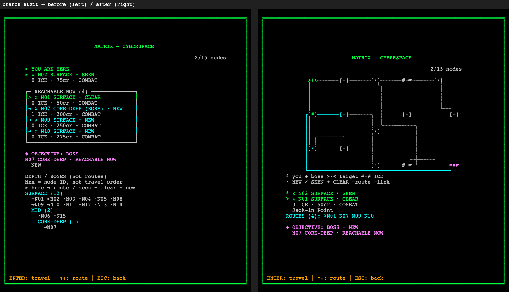

# Matrix operation board — evidence, 2026-11-01

Implements [ADR-0249](../../wiki/decisions/0249-matrix-operation-board.md). Renderer/data-presentation change only: reducer, selection semantics, encounter verbs, prices, tuning, RNG, `status.ts`, dungeon crawler and VFX are unchanged. Work is unstaged and uncommitted.

## Before / after

**Actual `renderMatrix` outputs**, not mockups. Before grids were captured from HEAD (`b480aae8`) before any edit; the branch-80x50 before text is byte-identical to the previous slice's after capture. PNGs draw the saved cell grids through the game's real `AsciiRenderer` (bundled with esbuild into headless Chromium), 10×18 px cells, DPR 1, system monospace fallback, no external HUD. Fixture: grade 3, seed 42, 15 nodes ([fixture.json](fixture.json)); states start (node 0), branch (node 1, visited [0,1], cleared [0], target 0), boss (node 6, all visited). See [capture receipt](capture-receipt.json).

| Grid | Pairs (before left / after right) | Raw after |
| --- | --- | --- |
| 80×50 | [start](start-80x50-pair.png) · [branch](branch-80x50-pair.png) · [boss](boss-80x50-pair.png) | [start](start-80x50-after.txt) · [branch](branch-80x50-after.txt) · [boss](boss-80x50-after.txt) |
| 60×40 | [start](start-60x40-pair.png) · [branch](branch-60x40-pair.png) · [boss](boss-60x40-pair.png) | [start](start-60x40-after.txt) · [branch](branch-60x40-after.txt) · [boss](boss-60x40-after.txt) |
| 40×60 | [start](start-40x60-pair.png) · [branch](branch-40x60-pair.png) · [boss](boss-40x60-pair.png) | [start](start-40x60-after.txt) · [branch](branch-40x60-after.txt) · [boss](boss-40x60-after.txt) |

## Integrity rules → enforcement

| # | Rule | Enforcement | Test (`web/tests/matrix_board.test.ts`) |
| --- | --- | --- | --- |
| 1 | Adjacency/edges always shown | Corridors depend only on matrix + board geometry, never on visited/cleared | rule 1: all-NEW vs all-known draw every corridor cell |
| 2 | Whole topology one screen, boss persistent `◆` | Scale-to-fit (generator ≤15×10), no camera/scroll; boss token always contains `◆` | rule 2: every site inside frame, `◆` only and always on boss, every current node × 3 layouts |
| 3 | Arrows select, Enter confirms; no auto-select | Renderer draws `selectedMatrixNodeIndex` only; reducer untouched | rule 3: nothing targeted at rest; each ArrowDown targets exactly the reducer's choice |
| 4 | Arrival: no default verb, no auto-exec | Reducer untouched; board shows no target after travel | rule 4: arrival → no decision, no target; next confirm opens menu with `selectedVerb === null` |
| 5 | No separate minimap | Board is the only map; `DEPTH / ZONES` stack deleted | rule 5: exactly one token per room (+2 legend samples); no list stack |
| 6 | `MatrixNode.adjacent` authoritative | One corridor per undirected adjacency; never through/into a non-endpoint room | rule 6: corridor set = adjacency pairs (independent oracle); every link enters only its endpoints; no drawn corridor glyph without a routed cell |
| 7 | Colour never sole carrier | `@`, `◆`, `>·<`, `#·#`, `·/✓/+`, three corridor glyph sets | rule 7: reads position/boss/target/route/link from characters only |
| 8 | One confirmed move = one route action | Corridors are drawn, never walked; board memoised per matrix | rule 8: one confirm = one `turnCount`, sites/corridors identical before/after, `@` moved |

Pre-change run of the new file on a HEAD checkout: **13 failed / 0 passed** ([integrity-tests-before.txt](integrity-tests-before.txt)). After: **13 passed**.

## Verification

| Command | Result |
| --- | --- |
| `npm run typecheck` | 0 errors |
| `npm run lint` | 0 errors; pre-existing `src/input/keyboard.ts:14` warning |
| `npm test` | **167 files / 3754 passed / 0 failed** (baseline 166 / 3741, +13) |
| `npm run build` | PASS, 124 modules |
| `npx prettier --write/--check` on edited `src/**` only | PASS |
| `npm run balance` / `-- --deck ppl` | [opening](balance-opening.txt) / [PPL](balance-ppl.txt); `cmp` byte-identical to pre-edit runs **and** to the previous slice's ADR-0239 baseline files |
| E2E (`env -u CI PLAYWRIGHT_BASE_URL=http://127.0.0.1:5195 …`) | **82 passed / 4 skipped / 0 failed (4.6m)** against the already-running preview (pid unchanged, not killed; it serves the rebuilt `dist/`) |
| Layout stress | **3132 cases** (grades 1–6 × seeds 0–9 × every node × 3 layouts), max 33 nodes / frontier 5, 0 unrouted adjacencies; [layout-evidence.json](layout-evidence.json) |
| TUI width checks | 9/9 after captures: exact width, 0 overflow, no border drift, no wide chars, no ANSI (`*-width-check.json`) |
| Frontend draft guard | clean, 6 renderer files |
| LSP | unavailable (no TS server installed); CLI typecheck is the gate |

## Visual QA — fixed dark ASCII surface

Contrast **measured** ([contrast.json](contrast.json)): all Matrix tokens across 4 palette modes × standard/high-contrast; minimum **5.75:1** (`ICE_BLUE`, preview only); new corridor link colour `GRAY_MID` 6.58:1. Independent read-only reviewer inspected all nine after captures against the fixture and two pair PNGs: **PASS**, no product defect; noted 40×60 density as taste.

| Item | Verdict | Note |
| --- | --- | --- |
| Hierarchy: where am I / routes / target / objective | PASS | `@`, solid routes, `>·<`, card, `◆` |
| Required content at all 3 layouts | PASS | stress + 9 captures |
| Rails / frame / footer intact, no overflow | PASS | width checks, stress |
| Text contrast ≥ 4.5:1 | PASS | measured 5.75:1 min |
| Colour not sole carrier | PASS | rule 7 test |
| Density at 40×60 (grade 5–6 graphs) | PASS (taste note) | dotted links cross; routes from `@` stay solid |
| Motion / travel feedback | N/A | not in this slice (ADR open risk) |
| Light theme, pointer, scroll | N/A | fixed dark canvas, keyboard, no scroll |
| Per-row focus ring | **FAIL (inherited)** | canvas, unchanged |
| Semantic accessibility tree | **FAIL (inherited)** | canvas, unchanged |

Highlight cycle order **unchanged** (reducer untouched); `web/e2e/menu-nav.ts` `gotoEncounterDecision` needed no edit.
