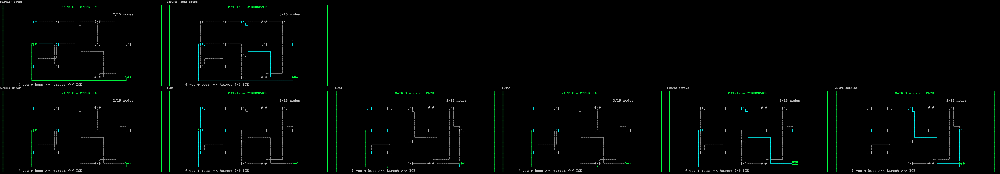

# Matrix travel animation — evidence, 2026-11-01

Follow-up to [ADR-0249](../../wiki/decisions/0249-matrix-operation-board.md). Owner play-test: "이제 노드들을 거쳐 따라다닐 수 있어" — the board can be traversed. The owner chose the next step: make a committed move read as movement. Unstaged, uncommitted.

## What the player sees

Before: Enter teleports `@` — on the next frame the origin is an empty room and `@` is already in the destination, which on the `long` fixture is 47 cells away.

After, for 220 ms after a confirmed move (Enter with a target):

| Time | Board |
| --- | --- |
| 0–160 ms (transit) | The board **and card** as the player confirmed it (card: `> Nxx` target, `@` origin). `@` lifts off the origin (which shows its own state glyph again) and runs the committed corridor, the cells the router already drew for that one adjacency. Cells behind `@` light up heavy green (`━┃┏┓┗┛`); cells ahead stay light cyan (`─│`). The destination keeps its target brackets `>x<`. Ease-out, so it leaves fast and settles in. |
| 160–220 ms (arrival) | The settled board, with the destination token inverted (black on green) as it takes the `@`. |
| ≥ 220 ms | The static board, byte-identical to HEAD. |

No camera, no scrolling, no board movement: rooms and every other corridor stay where they are. One `@` on the board in every frame.

## Purely visual — how it is kept that way

- **The reducer is unchanged.** `applyMatrixAction` still sets `currentNodeIndex` in the confirming action. The animation is derived *after* the action, in the controller: `this.matrixTravel = beginMatrixTravel(previous, this.state, performance.now(), this.reducedMotion)`.
- **Not on `GameState`.** `MatrixTravel { from, to, startedMs }` is a field on the `Game` controller (`main.ts`). It never enters the reducer, `stateToSaveSlot`, or the balance harness, which does not load `main.ts` at all. No `GameState` field was needed.
- **Wall clock only.** `matrixTravelFrame(travel, nowMs)` is a pure function of the caller's clock. A frozen clock (Playwright fake timers) holds one frame and changes nothing; the state is already final.
- **Input ends it.** Each input re-derives the travel: another move starts a new one, any other input clears it. Input never waits, and a traversal cannot be redirected — its `from`/`to` are fixed when it starts.
- **Only a confirmed one-edge move animates.** It starts only when the previous state had targeted the new node and the two nodes are adjacent. Targeting, CONTINUE jumps, and phase changes do not animate.
- **Reduced motion.** `suppressMotion("travel", reducedMotion)` (new `MotionKind`, ADR-0236 gate) returns null, so the board goes straight to the arrival. The controller flag is `resolveReducedMotion(loadReducedMotionOverride())`, the in-game override or else the OS media query.

Live check against the running preview build ([live-check.json](live-check.json)): a real BYPASS then ArrowDown then Enter, with every canvas frame recorded in-page via rAF.

| Mode | State right after Enter | Distinct canvas images |
| --- | --- | --- |
| motion (`wetrun_reduced_motion=0`) | moved (`cur 1`, `sel null`) | **10** over 173→392 ms ([live-motion-*.png](live-motion-04-t207.png)) |
| reduced (`wetrun_reduced_motion=1`) | moved (`cur 1`, `sel null`) | **2**: before and after, no intermediate ([live-reduced-*.png](live-reduced-01-t164.png)) |

## Captures

Actual `renderMatrix` grids drawn through the game's `AsciiRenderer` (esbuild bundle, headless Chromium, 10×18 cells, DPR 1), the same method as the previous three slices; [capture-receipt.json](capture-receipt.json). Fixture grade 3, seed 42 ([fixture.json](fixture.json)): `fwd` = N02 → N09 (short forward corridor), `long` = N02 → N07 (boss, long corridor). Frames: `commit` (Enter pressed, target lit), `t000` / `t060` / `t120` (transit at +0 / +60 / +120 ms), `t180` (arrival), `settled`. Before = HEAD `0cadd2c1` (no travel exists; `commit` then `settled`).

| Grid | Strips (top: BEFORE Enter → next frame; bottom: AFTER Enter → +0 → +60 → +120 → +180 → +220) |
| --- | --- |
| 80×50 | [fwd](fwd-80x50-pair.png) · [long](long-80x50-pair.png) |
| 60×40 | [fwd](fwd-60x40-pair.png) · [long](long-60x40-pair.png) |
| 40×60 | [fwd](fwd-40x60-pair.png) · [long](long-40x60-pair.png) |

Raw text: `<fwd|long>-<frame>-<size>-{before,after}.txt`. Static frames (`commit`, `settled`) are **byte-identical before/after** (12 text files `cmp`, and 6 settled PNG pairs at `diffRatio 0` in `*-image-diff.json`). Width checks: 36/36 after frames exact width, 0 overflow, no border drift, no ANSI (`*-width-check.json`).

## Tests

New [`web/tests/matrix_travel.test.ts`](../../../web/tests/matrix_travel.test.ts), 15 tests (14 at red phase + 1 added after review). At HEAD the file cannot load (module missing). Against a null stub of the new API: **13 failed / 1 passed** ([tests-before.txt](tests-before.txt)). The 1 that passes is a guard: with no travel, the board equals the static board. After: **15 passed**. The 15th (card agrees with the board during transit) failed with the review fix stashed and passes with it.

| Contract | Tests |
| --- | --- |
| State change immediate, same action | each neighbour: one `confirm` moves `currentNodeIndex`, `visitedNodes`, `turnCount`; the travel describes that move; drawing every frame at 3 layouts leaves the state JSON unchanged; bounded by the clock alone, ends by itself, frozen clock holds a frame |
| Reduced motion | `suppressMotion("travel")` true/false; no travel when suppressed, one otherwise; no-travel board = static board; `main.ts` passes `this.reducedMotion` from `resolveReducedMotion(loadReducedMotionOverride())` |
| No RNG | counting `Math.random` stub: reducer + travel + every frame at 3 layouts = reducer alone; the animation alone draws **0**, over more than 10 real frames (non-vacuous) |
| Unsaved | no `travel` key on the moved `GameState`; `stateToSaveSlot` JSON has no travel data |
| Card/board agreement | transit frames: card `@` = origin, destination targeted; arrival and settled: card `@` = destination |
| Rule 8 / no default target | `selectedMatrixNodeIndex` null after the move; no `>x<` bracket on the board at arrival or settled; only a confirmed one-edge move animates (positive control, targeting-only, non-adjacent jump, phase change); the path is exactly that adjacency's corridor at 3 layouts and never enters a room; exactly one `@` on the board in every frame, advancing monotonically to the last corridor cell, then on the destination centre; arrival inverts the destination token; `main.ts` re-derives the travel after every `applyAction` and never feeds it back |

Existing tests unchanged; the `matrix_affordance` pin on the `renderRunScreen` call is kept, so the static call is untouched and a second call is used only while a travel frame exists.

## Verification

| Command | Result |
| --- | --- |
| `npm run typecheck` | 0 errors |
| `npm run lint` | 0 errors; pre-existing `src/input/keyboard.ts:14` warning |
| `npm test` | **169 files / 3789 passed / 0 failed** (baseline 168 / 3774, +1 file / +15) |
| `npm run build` | PASS |
| `npx prettier --write/--check` on edited `src/**` + new test only | PASS |
| `npm run balance` / `-- --deck ppl` | [opening](balance-opening.txt) / [PPL](balance-ppl.txt): `cmp` byte-identical to the previous slice's files; opening `100.0 / 88.3 / 70.5 / 39.5 / 36.2 / 0.0`, PPL `100.0 / 79.1 / 98.9 / 83.0 / 44.4 / 24.7` (ADR-0239) |
| E2E (`env -u CI PLAYWRIGHT_BASE_URL=http://127.0.0.1:5195 … --grep-invert demo-screenshots`) | **82 passed / 4 skipped / 0 failed (4.6m)** ([e2e.txt](e2e.txt)); preview pid 75395 untouched, serving the rebuilt `dist/` (`index-BMcI1Sip.js`, rebuilt after the review fix; E2E re-run on it); `e2e/menu-nav.ts` unedited |
| Frontend draft guard (`check-draft-guard.ts` via `npx tsx`; `bun` not installed) | clean, 6 files |
| LSP | not available (no TS server); `tsc` is the gate |

## LOC (total / pure, pure = non-blank, non-comment)

| File | Before | After |
| --- | --- | --- |
| `renderer/matrix_travel.ts` (new) | — | 185 / 146 |
| `renderer/matrix.ts` | 203 / 167 | 223 / 183 |
| `renderer/matrix_board.ts` | 196 / 172 | 202 / 176 |
| `renderer/run_screen.ts` | 131 / 123 | 135 / 126 |
| `renderer/accessibility_modes.ts` | 239 / 126 | 246 / 132 |
| `main.ts` (pre-existing over cap) | 1747 / 1528 | 1783 / 1555 |

All touched modules except the pre-existing `main.ts` stay under the ADR-0110 ~250 pure-LOC cap.

## Visual QA — fixed dark ASCII canvas, with motion

Contrast measured ([contrast.json](contrast.json)), 4 palette modes × standard/high-contrast: travelling `@` + lit trail (GREEN_NEON on black) **≥ 13.96:1**; corridor ahead (CYAN_LIGHT) **≥ 10.93:1**; arrival inversion (black on GREEN_NEON) **≥ 13.96:1**. Lit trail vs unlit corridor is only 1.09–1.41:1 *between the two hues*. That is why the trail also changes glyph weight (heavy `━┃` vs light `─│`): the difference is in the glyph, not only the hue.

Independent read-only reviewer (all 48 text frames, strips, live PNGs, code): first verdict **REVISE**, with one product defect. During transit the card already showed the destination as `@` while the board's `@` was still in the corridor, so the card and the board disagreed about where the player is. **Fixed**: for the 160 ms transit the card is drawn from the confirmed move (target = destination, `@` = origin), matching the board; arrival and settled use the real state. The new test and re-captured frames pin it (e.g. `long-t060-80x50-after.txt`: card `> ⚔ N07 … / @ ⚔ N02`). Items 2–9 PASS.

| Item | Verdict | Note |
| --- | --- | --- |
| Destination conveyed | PASS (after fix) | `>x<` on destination + lit trail growing toward it; card names it as target |
| Can it be misread? | PASS (after fix) | exactly one board `@` per frame; only the committed corridor lights; no `>x<` after arrival; card agrees with board. Residual: in transit the target line shows the destination as `SEEN` (it is already in `visitedNodes`), not `NEW`. Cosmetic, 160 ms |
| Arrival reads | PASS | 60 ms inverted destination token, then static board |
| Monotonic, committed corridor, no intermediate room (rule 8) | PASS | tested at 3 layouts for every neighbour |
| No camera / scroll / board shift | PASS | rooms and other corridors fixed across frames |
| Rails / frame / footer, 40×60 unclipped | PASS | 36/36 width checks |
| Text contrast ≥ 4.5:1 | PASS | min 10.93:1 |
| Colour not sole carrier | PASS | `@` position + heavy/light glyph weight |
| Reduced motion | PASS | live: 2 distinct images (no intermediate) vs 10 with motion |
| Input never blocked / redirected | PASS | each input re-derives; travel `from`/`to` fixed at start |
| Duration | PASS (taste) | 220 ms total, inside 150–250; owner judgement by play remains (ADR-0249 open risk) |
| Per-row focus ring | **FAIL (inherited)** | canvas, unchanged |
| Semantic accessibility tree | **FAIL (inherited)** | canvas, unchanged; the traversal is not announced to assistive tech |

Known limits: the footer during transit describes the real (post-move) next action, because it tells the player what the next key does. The animation is per page session, with no setting beyond reduced motion.
